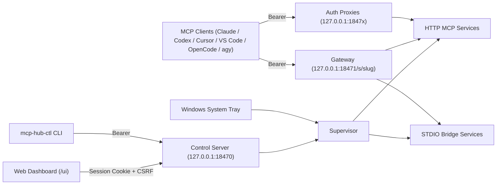

# mcp-hub

[English](README.md) | [简体中文](README.zh-CN.md) | [Security Policy](SECURITY.md)

A zero-dependency Go standard-library local MCP daemon supervisor, STDIO-to-Streamable-HTTP bridge, authenticated reverse proxy, and single-port loopback gateway for Windows (with cross-platform core support for Linux).

Instead of letting every editor or agent window spawn duplicate `node.exe` / Python MCP processes, `mcp-hub` runs one silent background supervisor with a custom-drawn Windows 11 system tray, an embedded local Web Dashboard, per-token MCP tool ACLs, idle sleep with lazy wake, and a scriptable JSON-first CLI.

Current version: `0.3.0`.

## Highlights

- **Zero third-party dependencies**: Built purely with the Go standard library, native Windows syscalls, and an embedded vanilla HTML/CSS/JS dashboard (`embed.FS`, no CDN, no npm build step).
- **Single-instance & orphan-free process trees**: Enforces one supervisor via `Local\McpHubSupervisor` and binds every managed service to a Windows `KILL_ON_JOB_CLOSE` Job Object (`CREATE_NO_WINDOW`), so child trees (such as Playwright browsers) exit cleanly when the hub stops or crashes.
- **HTTP supervision + STDIO-to-Streamable-HTTP gateway**: Supervise native Streamable HTTP MCP servers and bridge STDIO MCP servers (e.g., `@modelcontextprotocol/server-filesystem`, `@modelcontextprotocol/server-memory`) onto `http://127.0.0.1:18471/s/<slug>` with automatic session tracking and cancellation on client disconnect.
- **Idle sleep & lazy wake**: Start services on demand (`startMode: "lazy"`), sleep idle processes automatically (`idleSleepSec` / `abandonedSessionSleepSec`), wake or sleep manually from the Tray/Dashboard/CLI, and track `CrashRestarts` separately from normal `WakeCount`.
- **Per-token MCP tool ACLs & read-only mode**: Issue scoped Bearer tokens per agent with `allowTools` / `denyTools` glob rules and `readOnlyOnly: true` (`readOnlyHint: true`). Filtered `tools/list` responses and fail-closed `tools/call` enforcement happen at the gateway/proxy boundary.
- **Custom-drawn Windows 11 System Tray**: Per-Monitor V2 high-DPI Control Popover and Quick Menu, adaptive Light/Dark themes (`AppsUseLightTheme`), vector icons, and an adaptive Tri-Node Hub icon reflecting live aggregate health (`ok`, `sleeping`, `starting`, `degraded`, `error`). Set `"tray": false` to run completely headless.
- **Embedded Local Web Dashboard (`/ui`)**: Overview and service detail drawer with 1-click client config snippets, live SSE log streaming, per-tool call/error/latency analytics, and a safe MCP Tools Explorer that will not wake sleeping services unless opted in.
- **Agent-first CLI (`mcp-hub-ctl`)**: Stable exit codes (`0`..`6`), `--json` output on every command, live `status --watch`, `stats`, `tools`, `probe`, `snippet`, `audit --fix-acl`, `sleep`/`wake`, `ui`, `init`, and zero-downtime token rotation.

## Architecture

Two binaries share `./internal/hub`:

- `mcp-hub.exe` (`-ldflags "-H=windowsgui -s -w"`): Windowless background supervisor with optional custom-drawn Windows system tray and embedded Web Dashboard.
- `mcp-hub-ctl.exe` (`-ldflags "-s -w"`): Console CLI for status, metrics, tool inspection, lifecycle control, hot reload, end-to-end probing, client snippets, auditing, and token rotation.



## Quick Start

### Option 1: Install from Source (Windows)

Requires Go 1.25+ on `PATH`.

```powershell
# Build and install into %LOCALAPPDATA%\Programs\McpHub (data in %LOCALAPPDATA%\McpHub)
pwsh -NoProfile -File .\install-local.ps1

# Bootstrap an initial config.json and private control.token
mcp-hub-ctl init

# Validate configuration, register login startup, and start the hub
mcp-hub-ctl validate
pwsh -NoProfile -File .\install-local.ps1 -RegisterStartup -Start

# Open the embedded local Web Dashboard
mcp-hub-ctl ui
```

You can also run `install-local.ps1` with Windows PowerShell 5.1 (`powershell.exe -NoProfile -File .\install-local.ps1`) and customize directories with `-InstallDir` and `-DataDir`:

```powershell
powershell.exe -NoProfile -File .\install-local.ps1 `
  -InstallDir 'C:\Tools\McpHub' `
  -DataDir 'C:\Tools\McpHubData' `
  -RegisterStartup -Start
```

### Option 2: Prebuilt Release

Download `mcp-hub-v0.3.0-windows-amd64.zip` (or `arm64`) and `SHA256SUMS.txt` from [GitHub Releases](https://github.com/TheWiseWolfHolo/mcp-hub/releases), verify the checksum, extract both binaries, and run:

```powershell
.\mcp-hub-ctl.exe init
.\mcp-hub.exe run
```

### Portable Config Discovery

When `--config` is not specified, `mcp-hub` and `mcp-hub-ctl` resolve the default config path in this order:

1. `MCP_HUB_CONFIG` environment variable (if set).
2. `config_path` from `installation.json` adjacent to the running executable.
3. `%LOCALAPPDATA%\McpHub\config.json` on Windows (or `$XDG_CONFIG_HOME/mcp-hub/config.json` / user config directory on Unix).

## Windows System Tray & Web Dashboard

### System Tray

Enabled by default (`"tray": true`). Left-clicking opens the custom-drawn Control Popover showing live service status, RAM usage, uptime, quick per-service actions (`Start/Wake`, `Restart`, `Reload`, `Sleep`, `Stop`, `Open Log`), and top-level controls (`Open Web Dashboard`, `Reload Config`, `Restart All`). Right-clicking opens the compact Quick Menu.

The Tri-Node Hub icon adapts automatically to Windows Light/Dark taskbar themes and switches state badges for `ok`, `sleeping`, `starting`, `degraded`, and `error`. Set `"tray": false` in `config.json` to run with no UI.

### Embedded Web Dashboard (`/ui`)

Served directly from `controlAddr` (default `http://127.0.0.1:18470/ui/`). Launch it from the System Tray (**Open Web Dashboard**) or via CLI (`mcp-hub-ctl ui`), which mints a single-use 256-bit bootstrap nonce and redirects into an `HttpOnly; SameSite=Strict` browser session.

Views included:

- **Overview & Services**: Metric strip (healthy/sleeping counts, total tree RAM, uptime, active SSE/requests), filterable services table distinguishing crash restarts from idle wakeups, proxies and gateway summary, and a slide-out Service Detail Drawer with 1-click client config snippets (`claude`, `codex`, `cursor`, `vscode`, `agy`, `opencode`, `devin`).
- **Live Logs**: Real-time SSE tailing for `hub` or any managed service with search, pause/resume, auto-scroll, and copy controls. All output is redacted.
- **Tool Analytics & MCP Explorer**: Sortable per-tool call counts, error counts, and average latency across all services, plus an on-demand MCP Tools Explorer displaying `readOnlyHint` badges and collapsible JSON schemas. Sleeping services are skipped unless "Wake if sleeping" is checked.

## Configuration

See [config.example.json](config.example.json) for a complete, validated configuration using public MCP servers (`@playwright/mcp`, `@modelcontextprotocol/server-filesystem`, `@modelcontextprotocol/server-memory`, and a local HTTP MCP server). Unknown JSON fields are rejected.

### Top-Level Fields

| Field | Description |
| --- | --- |
| `controlAddr` | Control API listen address (default `127.0.0.1:18470`, must be loopback) |
| `controlTokenFile` | Path to Bearer token file for control API; required unless `allowInsecureNoControlAuth: true` |
| `logDir` / `logMaxBytes` | Log directory and per-file rotation limit (default 5 MiB, keeps one `.old` file) |
| `tray` | Show Windows System Tray icon (default `true`) |
| `gateway` | Single-port gateway: `listenAddr` (default `127.0.0.1:18471`), `allowedHosts`, `routes[]` |
| `services[]` / `proxies[]` | Managed services and per-port authenticated reverse proxies |

### `services[]`

Common fields: `name`, `mode` (`"http"` default or `"stdio-bridge"`), `startMode` (`"eager"` default for HTTP, `"lazy"` default for `stdio-bridge`), `command`, `args`, `cwd`, `env`, `envFiles` (secret files injected at process launch), `healthUrl` (`http(s)://` expecting 2xx or `tcp://127.0.0.1:<port>`), `healthIntervalSec`, `port`, `shutdownUrl`, `shutdownTokenFile`, `reloadUrl`, `reloadTokenFile`, `idleSleepSec` (`stdio-bridge` defaults to 600s, `-1` disables; HTTP defaults to `0` disabled), `abandonedSessionSleepSec`, `startTimeoutSec` (default `15`), `maxConsecutiveFailures` (default `5`), `stripProxyEnv` (default `true`), `clientPath` (default `"/mcp"`), `description`, `tags`, `allowNonLoopback`.

`stdio-bridge` also supports `requestTimeoutSec` (default `120`), `initTimeoutSec` (default `20`), `maxConcurrent` (default `32`), and `maxLineBytes` (default 32 MiB).

### `proxies[]` and `gateway.routes[]`

- `proxies[]`: `name`, `listenAddr`, `targetUrl`, `tokenFile` or `tokens[]` (at least one required), `upstreamTokenFile` (injects upstream Bearer; otherwise strips client `Authorization`), `upstreamService` (auto-inferred by port when omitted), `healthPath`, `allowedHosts`, `clientPath`, `allowNonLoopback`.
- `gateway.routes[]`: `slug`, `service` (omit `targetUrl` for `stdio-bridge`; auto-inferred for HTTP services), `targetUrl`, `tokenFile` or `tokens[]`, `upstreamTokenFile`, `healthPath`, `clientPath`, `description`, `allowNonLoopback`.
- `tokens[]` entries: `name`, `tokenFile`, `allowTools[]`, `denyTools[]`, `readOnlyOnly`.

## Control API

All API routes enforce loopback `Host` allowlist, reject non-empty `Origin` and `OPTIONS`, and enforce `Sec-Fetch-Site`. Every route except `GET /healthz` (and `/ui` cookie-authenticated browser views) requires `Authorization: Bearer <control token>`.

| Method & Path | Purpose |
| --- | --- |
| `GET /healthz` | Unauthenticated health summary (services, proxies, gateway) |
| `GET /status` | Detailed supervisor status: PID, uptime, hub & tree RAM, goroutines, metrics, errors |
| `GET /catalog` | Service client URLs, auth metadata, and capabilities |
| `GET /events` | Real-time SSE stream of service state/health/reload events |
| `GET /logs/<name\|hub>?lines=N[&follow=1]` | In-memory ring log (128 lines); `follow=1` streams SSE with `Last-Event-ID` support |
| `POST /start/<name>` / `POST /stop/<name>` | Start or stop a service |
| `POST /restart/<name>[?wait=healthy]` | Restart a service; `wait=healthy` waits until healthy |
| `POST /sleep/<name>` / `POST /wake/<name>` | Put an idle-capable service to sleep or wake a lazy/sleeping service |
| `POST /services/start-all` / `stop-all` / `restart-all` | Bulk lifecycle actions across managed services |
| `POST /config/validate` | Dry-run config reload preview without applying changes |
| `POST /reload` | Hot-reload `config.json`, proxies, gateway, and all token files |
| `POST /reload/<name>` | Forward reload trigger to the service's `reloadUrl` |
| `POST /stop` | Gracefully stop the hub |
| `POST /ui/session` | Mint a single-use bootstrap URL for the embedded Web Dashboard (`/ui`) |

## CLI Reference (`mcp-hub-ctl`)

Global flags can appear anywhere on the command line: `-c`/`--config`, `--addr`, `--token-file`, `--timeout` (default `20s`), `--json`.

| Command | Description |
| --- | --- |
| `init` | Create a starter `config.json` and private `control.token` in the default data directory |
| `health` | Print `/healthz` summary; exits `1` if unhealthy |
| `status [--watch [2s]]` | Show supervisor header, services, proxies, gateway, and recent errors |
| `stats [service]` | Show per-tool call counts, error counts, and average latency |
| `logs <service\|hub> [-n 50] [-f] [--offline]` | Tail ring logs (`-f` SSE) or read `<logDir>/<name>.log` offline |
| `start <service\|--all>` / `stop <service\|--all>` | Start or stop managed services (`stop` without target exits `2`) |
| `restart <service\|--all> [--wait]` | Restart services; `--wait` blocks until healthy |
| `sleep <service>` / `wake <service>` | Manually sleep or wake a service |
| `shutdown [--wait]` | Stop the hub daemon (`--wait` confirms exit) |
| `reload [service] [--dry-run]` | Hot-reload hub config/tokens (`--dry-run` previews diff), or trigger a service's `reloadUrl` |
| `catalog [--probe-tools] [--wake]` | List configured MCP endpoints and optionally inspect tools |
| `tools <service> [--wake]` | Probe and list MCP tools with read-only badges for a service |
| `probe [service] [--mcp] [--wake]` (alias `doctor`) | End-to-end check: health, auth, Host/Origin 403 guards, missing-token 401 guards, optional MCP handshake |
| `snippet <service> [--client <name\|all>]` | Generate ready-to-paste client config (`claude`, `codex`, `cursor`, `vscode`, `agy`, `opencode`, `devin`, `all`) with `<TOKEN_FROM: path>` placeholders |
| `ui [--no-open]` | Mint a one-time bootstrap URL and open the local Web Dashboard in your browser |
| `validate` | Validate config syntax, secret files, executables, and working directories |
| `audit [--fix-acl]` | Audit private NTFS ACLs, weak/reused tokens, inline secrets, non-loopback overrides, and binary SHA-256 receipts |
| `init-token <path> [--force]` | Generate a 256-bit hex token into a private-ACL file (prints path + short `sha256:` fingerprint only) |
| `rotate-token <path> --stage\|--commit [--no-reload]` | Two-phase zero-downtime token rotation |
| `version` | Print version and commit hash |

### Exit Codes

| Code | Meaning |
| --- | --- |
| `0` | Success |
| `1` | Runtime error, unhealthy status, failed probe, or partial batch failure |
| `2` | Usage error, invalid configuration, or unreadable token file |
| `3` | Hub unreachable or request timed out |
| `4` | Authentication or guard failure (`401` / `403`) |
| `5` | Service or log not found (`404`) |
| `6` | Security audit found violations |

With `--json`, all output (including errors) is written to stdout as JSON: `{"ok":false,"error":{"code":"...","message":"...","hint":"..."}}`.

### Zero-Downtime Token Rotation

```powershell
# 1. Stage a new token into control.token.next and reload so both tokens work
mcp-hub-ctl rotate-token "$env:LOCALAPPDATA\McpHub\secrets\control.token" --stage

# 2. Update clients to read the new token from control.token.next

# 3. Promote .next to the primary file, reload, and verify the old token returns 401
mcp-hub-ctl rotate-token "$env:LOCALAPPDATA\McpHub\secrets\control.token" --commit
```

## Installer & Upgrades (`install-local.ps1`)

Parameters: `-InstallDir`, `-DataDir`, `-SymlinkDir` (default `%USERPROFILE%\.local\bin`), `-RegisterStartup`, `-Start`, `-NoStart`, `-NoSymlink`, `-Uninstall`, `-PostStartCheck`.

- Builds both binaries into a same-volume staging directory (`.install-<guid>`) with `-trimpath` and `GitCommit` ldflags, leaving any running hub uninterrupted during preflight validation.
- Verifies and enforces owner-only protected NTFS ACLs on `-DataDir` (refusing reparse points).
- Gracefully stops the installed hub, swaps binaries atomically with full rollback on failure, verifies `/healthz` against the new PID (IPv4 and IPv6 `[::1]`), creates a symlink (or same-drive hardlink fallback) for `mcp-hub-ctl.exe`, and atomically writes `installation.json` with binary SHA-256 hashes.
- `-Uninstall` stops the hub and removes installed binaries, matching startup entries, and links while preserving your data directory.

## Security

See [SECURITY.md](SECURITY.md) for the complete threat model, HTTP guard pipeline, Web Dashboard session/CSRF architecture, NTFS DACL model, and vulnerability reporting instructions.

## Development & Testing

```powershell
$env:GOTMPDIR = $env:TEMP
go vet ./...
$env:GOOS = 'linux'; go vet ./...; Remove-Item Env:GOOS
go test -race -count=1 ./...
go build ./cmd/mcp-hub ./cmd/mcp-hub-ctl
```

## License

MIT License. See [LICENSE](LICENSE).
