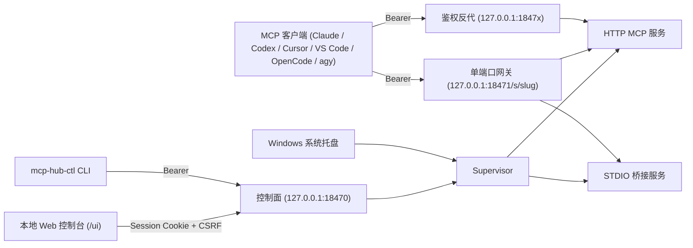

# mcp-hub

[English](README.md) | [简体中文](README.zh-CN.md) | [安全策略](SECURITY.md)

零第三方依赖（仅 Go 标准库）的本地 MCP 守护进程监督器、STDIO 转 Streamable HTTP 桥接器、鉴权反向代理与单端口回环网关。主要面向 Windows，核心包同时支持 Linux 编译与测试。

本机多个 Streamable HTTP MCP 服务与 STDIO MCP 服务可以统一交给一个静默后台进程托管，各编辑器与 Agent 客户端只需连接回环地址加 Bearer 令牌，不再每开一个窗口就重复拉起多份 `node.exe` 或 Python 进程。

当前版本：`0.3.0`。

## 主要特性

- **零第三方依赖**：仅使用 Go 标准库、原生 Windows 系统调用与 `embed.FS` 内嵌的纯静态 HTML/CSS/JS（无外部 CDN、无 npm 构建链）。
- **单实例与孤儿进程防护**：通过命名互斥锁 `Local\McpHubSupervisor` 保证单实例；每个托管子进程以 `CREATE_NO_WINDOW` 启动并绑定 Windows `KILL_ON_JOB_CLOSE` 作业对象，守护进程退出或崩溃时内核自动回收整棵子进程树（含 Playwright 拉起的浏览器）。
- **HTTP 监督与 STDIO 桥接网关**：同时托管原生 Streamable HTTP MCP 服务与 STDIO MCP 服务（如 `@modelcontextprotocol/server-filesystem`、`@modelcontextprotocol/server-memory`），后者经由 `http://127.0.0.1:18471/s/<slug>` 暴露为 Streamable HTTP，支持会话追踪与客户端断开取消。
- **懒启动与空闲休眠**：支持按需拉起（`startMode: "lazy"`）、空闲自动休眠（`idleSleepSec` / `abandonedSessionSleepSec`）、手动 `sleep`/`wake`，并将异常崩溃重启（`CrashRestarts`）与正常唤醒次数（`WakeCount`）分开计数。
- **按令牌粒度的工具 ACL 与只读模式**：可为不同客户端签发独立 Bearer 令牌，配置 `allowTools` / `denyTools` 通配规则及 `readOnlyOnly: true`（仅放行带 `readOnlyHint: true` 的工具），在网关与代理层过滤 `tools/list` 并拦截越权 `tools/call`。
- **Windows 11 自绘高分屏系统托盘**：支持 Per-Monitor V2 高 DPI 缩放、跟随系统浅色/深色主题（`AppsUseLightTheme`）的自绘控制弹窗与快捷菜单、清晰矢量图标，以及随整体健康状态切换的 Tri-Node Hub 图标（`ok` / `sleeping` / `starting` / `degraded` / `error`）。配置 `"tray": false` 可完全无界面运行。
- **内嵌本地 Web 控制台（`/ui`）**：服务总览与详情抽屉（含各客户端配置片段一键复制）、实时 SSE 日志流、按工具维度的调用次数/错误/平均耗时统计，以及默认不唤醒休眠服务的 MCP 工具浏览器。
- **面向 Agent 的 CLI（`mcp-hub-ctl`）**：所有命令均支持 `--json` 与稳定退出码（`0`..`6`），内置 `init`、`status --watch`、`stats`、`tools`、`probe`、`snippet`、`audit --fix-acl`、`sleep`/`wake`、`ui` 与两阶段无停机令牌轮换。

## 架构

两个二进制共用 `./internal/hub`：

- `mcp-hub.exe`（`-ldflags "-H=windowsgui -s -w"`）：无控制台窗口的守护进程，内置可选系统托盘与本地 Web 控制台。
- `mcp-hub-ctl.exe`（`-ldflags "-s -w"`）：控制台 CLI，负责初始化、状态监控、工具探测、启停/休眠/唤醒、热重载、客户端配置生成、安全审计与令牌轮换。



## 快速开始

### 方式一：源码构建并本地安装（Windows）

需要 `PATH` 中已安装 Go 1.25+。

```powershell
# 构建并安装到 %LOCALAPPDATA%\Programs\McpHub，运行数据默认在 %LOCALAPPDATA%\McpHub
pwsh -NoProfile -File .\install-local.ps1

# 生成初始 config.json 与受私有 ACL 保护的 control.token
mcp-hub-ctl init

# 校验配置、注册登录自启并立即启动
mcp-hub-ctl validate
pwsh -NoProfile -File .\install-local.ps1 -RegisterStartup -Start

# 在浏览器打开内嵌本地 Web 控制台
mcp-hub-ctl ui
```

`install-local.ps1` 同样兼容 Windows PowerShell 5.1，也支持通过 `-InstallDir` 和 `-DataDir` 指定自定义安装与数据目录：

```powershell
powershell.exe -NoProfile -File .\install-local.ps1 `
  -InstallDir 'C:\Tools\McpHub' `
  -DataDir 'C:\Tools\McpHubData' `
  -RegisterStartup -Start
```

### 方式二：使用预构建发行版

从 [GitHub Releases](https://github.com/TheWiseWolfHolo/mcp-hub/releases) 下载 `mcp-hub-v0.3.0-windows-amd64.zip`（或 `arm64`）和 `SHA256SUMS.txt`，校验哈希并解压后执行：

```powershell
.\mcp-hub-ctl.exe init
.\mcp-hub.exe run
```

### 默认配置路径解析顺序

未传 `--config` 时，`mcp-hub` 与 `mcp-hub-ctl` 按以下优先级查找配置文件：

1. 环境变量 `MCP_HUB_CONFIG`（若非空）。
2. 与当前可执行文件同目录的 `installation.json` 中的 `config_path`。
3. Windows 上为 `%LOCALAPPDATA%\McpHub\config.json`（Unix 上为用户配置目录）。

## 系统托盘与本地 Web 控制台

### 系统托盘

默认开启（`"tray": true`）。左键弹出自绘控制面板，直接显示各服务状态、内存占用、运行时长以及单服务操作（启动/唤醒、重启、重载、休眠、停止、打开日志），顶部提供打开 Web 控制台、重载配置与全部重启入口；右键打开紧凑快捷菜单。

托盘图标随 Windows 任务栏浅色/深色主题自适应，并按 `ok`、`sleeping`、`starting`、`degraded`、`error` 显示不同状态标识。设为 `"tray": false` 可完全静默无界面运行。

### 内嵌 Web 控制台（`/ui`）

直接挂载在控制面端口（默认 `http://127.0.0.1:18470/ui/`）。可通过系统托盘「Open Web Dashboard」或执行 `mcp-hub-ctl ui` 打开。入口会签发一次性 256 位随机 bootstrap nonce，经 `303 See Other` 换取 `HttpOnly; SameSite=Strict` 会话 Cookie，并将 nonce 从地址栏和历史记录中移除。

包含三个主要视图：

- **总览与服务**：顶部指标条（健康/休眠计数、进程树总内存、运行时长、活跃 SSE 与请求数）、服务列表（区分崩溃重启与空闲唤醒）、反代与网关状态，点击服务可展开详情抽屉并一键复制各客户端配置片段（`claude`、`codex`、`cursor`、`vscode`、`agy`、`opencode`、`devin`）。
- **实时日志**：基于 SSE 实时查看 `hub` 或任意服务的脱敏日志，支持搜索过滤、暂停/继续、自动滚动与复制。
- **工具分析与 MCP 工具浏览器**：汇总全部服务的工具调用量、错误次数与平均延迟（支持排序）；按需探测目标服务暴露的工具列表、只读标记（`readOnlyHint`）与参数 JSON Schema，默认不唤醒休眠中的服务。

## 配置说明

完整示例见 [config.example.json](config.example.json)，使用常见公开 MCP 服务演示 HTTP、STDIO 桥接、单端口网关与鉴权反代。配置解析拒绝未知字段。

### 顶层字段

| 字段 | 说明 |
| --- | --- |
| `controlAddr` | 控制面监听地址，默认 `127.0.0.1:18470`，必须为回环地址 |
| `controlTokenFile` | 控制面 Bearer 令牌文件路径；必填，除非显式设置 `allowInsecureNoControlAuth: true` |
| `logDir` / `logMaxBytes` | 日志目录与单文件轮转上限（默认 5 MiB，滚动保留一份 `.old`） |
| `tray` | 是否显示 Windows 系统托盘，默认 `true` |
| `gateway` | 单端口网关：`listenAddr`（默认 `127.0.0.1:18471`）、`allowedHosts`、`routes[]` |
| `services[]` / `proxies[]` | 托管服务列表与独立端口鉴权反代列表 |

### `services[]` 常用字段

`name`、`mode`（默认 `http`，可选 `stdio-bridge`）、`startMode`（HTTP 默认 `eager`，`stdio-bridge` 默认 `lazy`）、`command`、`args`、`cwd`、`env`、`envFiles`（启动时读取受 ACL 保护的机密文件注入环境变量）、`healthUrl`（`http(s)://` 期望 2xx，或 `tcp://127.0.0.1:<port>`）、`healthIntervalSec`、`port`、`shutdownUrl`、`shutdownTokenFile`、`reloadUrl`、`reloadTokenFile`、`idleSleepSec`（`stdio-bridge` 默认 600 秒，`-1` 关闭；HTTP 默认 0 关闭）、`abandonedSessionSleepSec`、`startTimeoutSec`（默认 15）、`maxConsecutiveFailures`（默认 5）、`stripProxyEnv`（默认 `true`）、`clientPath`（默认 `/mcp`）、`description`、`tags`、`allowNonLoopback`。

`stdio-bridge` 额外支持 `requestTimeoutSec`（默认 120）、`initTimeoutSec`（默认 20）、`maxConcurrent`（默认 32）和 `maxLineBytes`（默认 32 MiB）。

### `proxies[]` 与 `gateway.routes[]`

- `proxies[]`：`name`、`listenAddr`、`targetUrl`、`tokenFile` 或 `tokens[]`（二选一至少一个）、`upstreamTokenFile`（向上游注入 Bearer，未配置时剥离客户端 `Authorization`）、`upstreamService`（省略时按端口自动推断）、`healthPath`、`allowedHosts`、`clientPath`、`allowNonLoopback`。
- `gateway.routes[]`：`slug`、`service`（指向 `stdio-bridge` 时省略 `targetUrl`；指向 HTTP 服务时可自动推断）、`targetUrl`、`tokenFile` 或 `tokens[]`、`upstreamTokenFile`、`healthPath`、`clientPath`、`description`、`allowNonLoopback`。每条路由令牌彼此隔离。
- `tokens[]` 条目：`name`、`tokenFile`、`allowTools[]`、`denyTools[]`、`readOnlyOnly`。

## 控制接口

所有接口均先校验回环 `Host` 白名单，拒绝非空 `Origin`、`OPTIONS` 与非法 `Sec-Fetch-Site`。除 `GET /healthz`（及走 Cookie+CSRF 的 `/ui` 浏览器页面）外均要求 `Authorization: Bearer <control token>`。

| 方法与路径 | 作用 |
| --- | --- |
| `GET /healthz` | 免鉴权健康摘要（服务、反代、网关） |
| `GET /status` | 详细状态：PID、运行时长、Hub 与进程树内存、协程数、调用指标、最近错误 |
| `GET /catalog` | 每个服务的客户端 URL、鉴权方式与支持能力 |
| `GET /events` | 实时状态与重载事件 SSE 流 |
| `GET /logs/<name\|hub>?lines=N[&follow=1]` | 128 行内存环形日志；`follow=1` 走 SSE，支持 `Last-Event-ID` |
| `POST /start/<name>` / `POST /stop/<name>` | 启动或停止单个服务 |
| `POST /restart/<name>[?wait=healthy]` | 重启服务，`wait=healthy` 等到健康再返回 |
| `POST /sleep/<name>` / `POST /wake/<name>` | 手动休眠或唤醒支持懒启动/休眠的服务 |
| `POST /services/start-all` / `stop-all` / `restart-all` | 批量启停或重启托管服务 |
| `POST /config/validate` | 配置热重载干跑预检，返回变更差异但不应用 |
| `POST /reload` | 热重载 `config.json`、反代、网关与全部令牌 |
| `POST /reload/<name>` | 转发重载请求到服务的 `reloadUrl` |
| `POST /stop` | 优雅停止整个 hub |
| `POST /ui/session` | 签发一次性本地 Web 控制台启动链接 |

## CLI 参考（`mcp-hub-ctl`）

全局参数可放在任意位置：`-c`/`--config`、`--addr`、`--token-file`、`--timeout`（默认 `20s`）、`--json`。

| 命令 | 作用 |
| --- | --- |
| `init` | 在默认数据目录初始化 `config.json` 与私有权限 `control.token` |
| `health` | 查看 `/healthz` 摘要；`ok=false` 时退出码 1 |
| `status [--watch [2s]]` | 展示守护进程概览、服务、反代、网关及近期错误 |
| `stats [service]` | 查看按工具维度的调用次数、错误数与平均耗时 |
| `logs <service\|hub> [-n 50] [-f] [--offline]` | 读取环形日志（`-f` 实时 SSE）或离线读取日志文件末尾 |
| `start <service\|--all>` / `stop <service\|--all>` | 启停服务；不带目标直接执行 `stop` 会报错（退出码 2） |
| `restart <service\|--all> [--wait]` | 重启服务，`--wait` 等到健康 |
| `sleep <service>` / `wake <service>` | 手动休眠或唤醒服务 |
| `shutdown [--wait]` | 停止守护进程，`--wait` 确认进程退出 |
| `reload [service] [--dry-run]` | 热重载 hub 配置与令牌（`--dry-run` 仅预览差异），或触发上游 `reloadUrl` |
| `catalog [--probe-tools] [--wake]` | 列出服务入口，可选实时探测工具列表 |
| `tools <service> [--wake]` | 探测并打印指定服务的 MCP 工具及只读标记 |
| `probe [service] [--mcp] [--wake]`（别名 `doctor`） | 端到端体检：健康检查、控制面鉴权、`Host`/`Origin` 403 拦截、无令牌 401 拦截及可选 MCP 握手 |
| `snippet <service> [--client <name\|all>]` | 输出可直接粘贴的客户端配置（`claude`、`codex`、`cursor`、`vscode`、`agy`、`opencode`、`devin`、`all`），令牌以 `<TOKEN_FROM: 路径>` 占位 |
| `ui [--no-open]` | 签发一次性链接并在浏览器中打开本地 Web 控制台 |
| `validate` | 校验配置结构、全部机密文件、命令与工作目录 |
| `audit [--fix-acl]` | 检查私有 NTFS ACL、弱令牌、复用令牌、内联机密、非回环例外与安装回执 SHA-256 |
| `init-token <path> [--force]` | 生成 256 位随机十六进制令牌并写入私有 ACL 文件，仅打印路径与 `sha256:` 前缀指纹 |
| `rotate-token <path> --stage\|--commit [--no-reload]` | 两阶段无停机令牌轮换 |
| `version` | 输出版本号与提交哈希 |

### 退出码

| 码 | 含义 |
| --- | --- |
| `0` | 成功 |
| `1` | 运行时错误、服务不健康、探测失败或批量操作部分失败 |
| `2` | 用法错误、配置无效或令牌文件不可读 |
| `3` | hub 不可达或请求超时 |
| `4` | 鉴权或守卫拦截（`401` / `403`） |
| `5` | 服务或日志不存在（`404`） |
| `6` | 安全审计发现违规项 |

加上 `--json` 后，所有结果与错误信息都以 JSON 输出到 stdout：`{"ok":false,"error":{"code":"...","message":"...","hint":"..."}}`。

### 无停机令牌轮换

```powershell
# 1. 生成新令牌写入 control.token.next 并热重载，新旧令牌同时有效
mcp-hub-ctl rotate-token "$env:LOCALAPPDATA\McpHub\secrets\control.token" --stage

# 2. 更新客户端改读 control.token.next 中的新令牌

# 3. 用新令牌替换正式文件、清理 .next、重载，并确认旧令牌已返回 401
mcp-hub-ctl rotate-token "$env:LOCALAPPDATA\McpHub\secrets\control.token" --commit
```

## 安装与升级（`install-local.ps1`）

可用参数：`-InstallDir`、`-DataDir`、`-SymlinkDir`（默认 `%USERPROFILE%\.local\bin`）、`-RegisterStartup`、`-Start`、`-NoStart`、`-NoSymlink`、`-Uninstall`、`-PostStartCheck`。脚本兼容 Windows PowerShell 5.1 与 PowerShell 7+。

- 在安装目录同卷的暂存目录（`.install-<guid>`）完成带 `-trimpath` 与 `GitCommit` 注入的构建与配置预检，期间正在服务的 Hub 不中断。
- 校验并修复 `-DataDir` 的用户独占 NTFS ACL，遇到符号链接或挂载点立即中止。
- 优雅停止旧 Hub、备份并替换二进制、拉起新进程并按 PID 校验 IPv4/IPv6 `[::1]` 的 `/healthz`；任何步骤失败自动回滚到上一版本。
- 为 `mcp-hub-ctl.exe` 创建符号链接（无开发者模式且同盘时自动回退为硬链接），并原子写入含二进制 SHA-256 的 `installation.json` 回执。
- `-Uninstall` 仅移除安装产物与归属本安装的启动项和链接，完整保留运行数据目录。

## 安全模型

完整威胁模型、回环守卫顺序、Web 控制台会话与 CSRF 边界、NTFS 私有权限与漏洞上报方式见 [SECURITY.md](SECURITY.md)。

## 开发与测试

```powershell
$env:GOTMPDIR = $env:TEMP
go vet ./...
$env:GOOS = 'linux'; go vet ./...; Remove-Item Env:GOOS
go test -race -count=1 ./...
go build ./cmd/mcp-hub ./cmd/mcp-hub-ctl
```

## 许可证

MIT License，详见 [LICENSE](LICENSE)。
